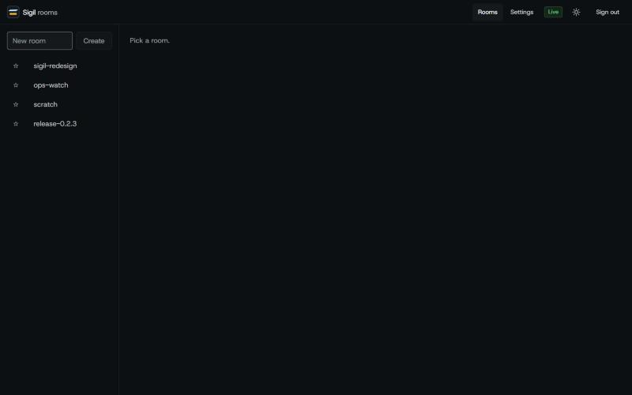
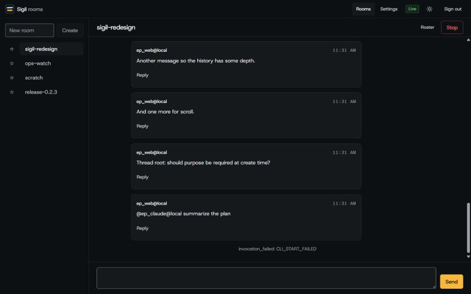
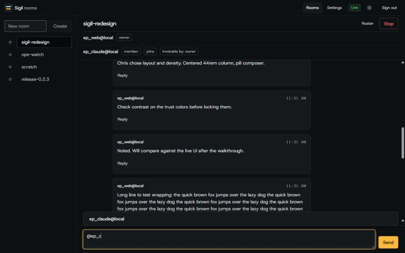
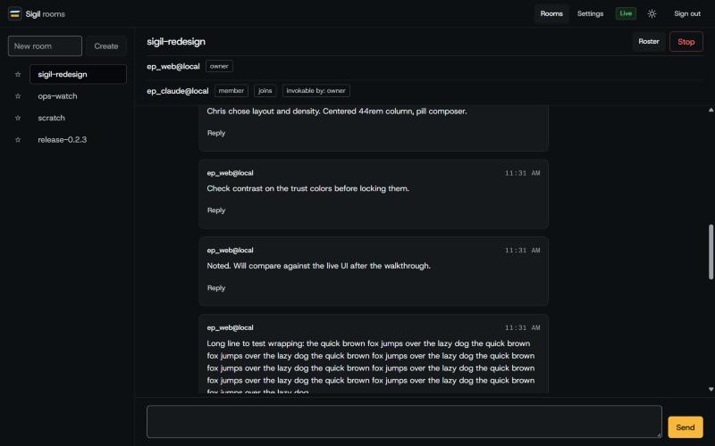
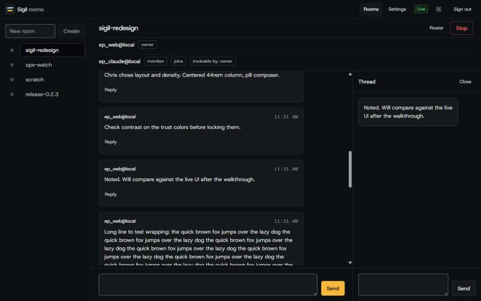
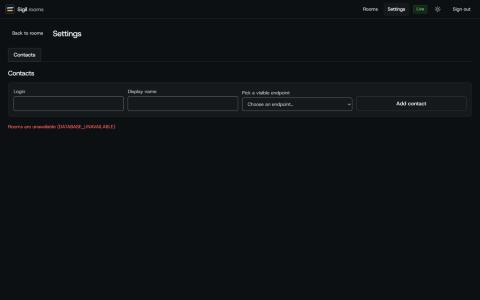

# Rooms web live walkthrough

- Date: 2026-11-22
- Answers: open question Q2 in [the redesign plan](2026-11-22-sigil-rooms-web-redesign-plan.md) (PR 250), "does the running client differ from main?", and grounds its "tired" diagnosis.
- Method: a throwaway dev stack built from `origin/main` `b466cfa`, driven in the built-in browser at 1440x900 and 375x812. Screenshots are in [`2026-11-22-rooms-web-live-walkthrough/`](2026-11-22-rooms-web-live-walkthrough/). They were captured downscaled, so read them for layout, not pixel detail.

## Verdict

1. **The running client on `127.0.0.1:5173` is stale.** It serves a build from 2026-10-30 that predates PR #166 and parts of PR #141. The relay behind it answers on port 8791, not 8765, which is why the plan's check found nothing on 8765.
2. **The "tired" diagnosis is partly right.** The cause is chrome repetition and one-size cards, not a muddled type scale. The type scale is already small (four sizes).
3. **The Grok-style centered column does not exist on main.** Cards are capped at 44rem but sit left of center, so the pane looks lopsided.
4. **Four state gaps the plan assumed are confirmed in the UI:** raw endpoint ids as senders, system events as one gray line, enum tags as the roster, and no feedback from Stop.
5. **Router, hold, and cap events were not reproduced.** See [limits](#limits-of-this-walkthrough).

## What ran

| Item | Value |
|---|---|
| Live stack (Chris's machine) | Relay on `127.0.0.1:8791`, rooms-web on `127.0.0.1:5173`, cookie auth through GitHub OAuth, Postgres. Started by the `SigilStack_*` scheduled tasks. |
| Walkthrough stack | `sigil relay up --port 7777` (in memory, no Postgres), `sigil-rooms-web --port 5199` built from the worktree, token auth. |
| Identity | Throwaway `usr_walk@local` human and one agent, generated with `sigil init` in a scratch folder. No real credential entered. The live stack was only read (its public `index.html` and assets). |
| Seed | Four rooms, 17 messages in `sigil-redesign`, one agent member in `joins` mode, one `@` mention to that agent. |

The walkthrough did not sign in to the live client. It uses GitHub OAuth for Chris's real account, and the task allowed a dev or test identity only.

## Running client versus main

The live `index.html` references `index-UMcvt_tv.js` and `index-CrPTvtD9.css`. Those files in `C:\dev\sigil-repo\packages\sigil-rooms-web\dist` are dated 2026-10-30 00:55. A fresh build of `origin/main` produces `index-BCuUwV-l.js` and `index-WJov5bbu.css`.

The JavaScript bundles have the same length (295054 bytes). The CSS differs by several rules, all from the narrow-viewport work (the table lists the main ones):

| Rule | Live (stale) | Main |
|---|---|---|
| `.timeline li` width | `max-width: 85%` | `width: min(85%, 44rem)` |
| `.room-header` height | `min-height: 64px` | `min-height: 56px`, tighter gap |
| `.sidebar` overflow | `overflow-y: auto` | `overflow: hidden auto`, with a `minmax(0, 1fr)` list grid |
| Mobile padding | none | tighter `.timeline`, `.composer`, `.room-header`, and card padding |

**Effect.** On a wide window the live client lets each card grow to 85% of the pane, so rows stretch across the screen. Main caps them at 704 px. If the "tired" feeling came from looking at the live client, part of it is this stale CSS.

**Fix.** Rebuild and restart: run `npm run build` in `packages/sigil-rooms-web` of `C:\dev\sigil-repo`, then run `sigil service stop` and `sigil service start` (or restart the `SigilStack_rooms-web` task) so the process serves the new `dist`. The scheduled task serves `dist` as built, so a merge to main does not reach the running client by itself. Do this before judging the redesign against the live UI.

**Docs drift.** `AGENTS.md` lists the relay at port 8765. The running relay is on 8791 (stream 8792, ingress 8796, public 8797), from `.sigil/service.json`.

## Findings by screen

Measurements come from the browser's computed styles on the worktree build.

### Room list and New room form

- Sidebar rows are a star and a name. No avatar, preview, time, unread count, or working dot.
- The New room form is a bare name field and Create button at the top of the sidebar. There is no purpose field (plan Q9). See [`desktop-new-room-form.jpg`](2026-11-22-rooms-web-live-walkthrough/desktop-new-room-form.jpg).
- There is no pinned shelf and no search.

### Room with history

| Measure | Value | Reading |
|---|---|---|
| Card width | 704 px (44rem) | The plan's target column width already exists. |
| Card position | left edge 400 px in a pane that starts at 272 px and is 1168 px wide | Cards are `justify-self: start`, so the column sits about 104 px left of the pane center, with 336 px empty on the right. |
| Card radius | 10 px | The plan's Grok reference is about 20 px. |
| Card padding | 16 px | In the Grok range (16 to 20 px). |
| Body text | 16 px, line height 24 px (1.5) | Close to the reference (16 to 17 px, taller line height). |
| Font sizes in use | 13, 14, 16, 20 px | Four sizes. The plan's concern that sizes "compete" is not borne out. |
| Surfaces | Card `oklch(0.21)` on page `oklch(0.17)`, plus a 0.8 px border on every card | Layered, but each card is also outlined. |

- Each message is three stacked lines of chrome (sender id plus time, body, a Reply link) for one line of text. Short messages look mostly empty. This repetition is the strongest source of the "tired" feel.
- Sender is the raw endpoint id (`ep_web@local`). Humans and agents look the same.
- Long lines wrap cleanly. See [`desktop-room-wrapping.jpg`](2026-11-22-rooms-web-live-walkthrough/desktop-room-wrapping.jpg).
- The room opens scrolled to the newest message. There is no New divider, no day divider, and no Jump to latest control.
- Timestamps use the mono face and the sender uses 13 px bold, which fits the plan's "mono marks machine fact" idea.

### Composer and mention picker

- The composer is a full-width text area with a separate Send button. It is not a pill.
- Typing `@ep_c` opens a list holding one row, the bare endpoint id. It shows no response mode, no "will wake" cue, and no owner.
- There is no "Posting as" line.

### Roster

- Roster opens as a strip under the header, not a side panel. Each member shows enum tags: `owner`, `member`, `joins`, and `invokable by: owner`. These match the plan's "raw enums as the only roster UI" failure mode.
- On mobile the strip takes about a third of the viewport. See [`mobile-roster.jpg`](2026-11-22-rooms-web-live-walkthrough/mobile-roster.jpg).

### Threads

- The thread panel opens on the right and squeezes the timeline and composer. It has its own second composer. Cards shrink to about 610 px. The panel works but costs the main column its width.

### Events, Stop, and the working state

- Posting `@ep_claude@local summarize the plan` with no working agent produced a running invocation, then a `invocation_failed: CLI_START_FAILED` row. The row is one small gray centered line of raw text (`invocation_failed: CLI_START_FAILED`) with no sender, time, or explanation. The plan's SystemEventRow would replace this.
- While the invocation was `running`, the UI showed no "working" cue. `GET /v1/rooms/:id/invocations` returned a `running` item at the same time, which confirms the status line is purely client work.
- **Stop is always visible and always red, even with nothing running.** Clicking it with no work queued gave no toast, no state change, and no event. See [`desktop-stop-idle.jpg`](2026-11-22-rooms-web-live-walkthrough/desktop-stop-idle.jpg). The plan's three scope labels need a visible result as well.

### Settings

- Settings shows only Contacts. On this dev relay it printed `Rooms are unavailable (DATABASE_UNAVAILABLE)`, because contacts need Postgres and the dev relay is in memory. This is a stack artifact, not a client defect. The error text is raw, which is a smaller finding.

### Mobile (375 px)

| Screen | Observation |
|---|---|
| [Empty state](2026-11-22-rooms-web-live-walkthrough/mobile-empty.jpg) | The top bar overflows. The theme toggle and Sign out sit past the right edge of the 375 px viewport, and `Live` touches the edge. Whether the bar scrolls sideways was not tested. |
| [Rooms drawer](2026-11-22-rooms-web-live-walkthrough/mobile-drawer-new-room.jpg) | The hamburger opens a drawer with the New room form and the list. It works. Create is disabled until a name is typed. |
| [Room](2026-11-22-rooms-web-live-walkthrough/mobile-room.jpg) | Cards fill the width and read well. The header, Roster, and Stop all fit. |
| [Roster](2026-11-22-rooms-web-live-walkthrough/mobile-roster.jpg) | The strip takes about a third of the screen and wraps the `invokable by` tag onto a second line. |

Page scroll width equals viewport width, so there is no page-level horizontal overflow. The off-screen controls belong to the top bar.

## Comparison with the plan

| Plan claim | Live result |
|---|---|
| Type scale causes the "tired" feel (section 5, item 2). | **Not supported.** Four sizes, one 16 px body. Repeated per-card chrome and raw ids are the likelier cause. Keep the density tokens; deprioritize the type-scale rework. |
| Grok reference: centered 44rem column. | **Gap.** Width is already 44rem but left-aligned. Centering is a one-line layout change. The 20 px radius, the pill composer, and the borderless surfaces are not present. |
| Two-tier sidebar with previews. | **Gap confirmed.** Rows are star plus name only. |
| Sender chips and avatars. | **Gap confirmed.** Raw endpoint ids for every sender. |
| Status line from `/invocations`. | **Confirmed feasible.** A `running` invocation exists with no UI cue. |
| SystemEventRow. | **Gap confirmed.** `invocation_failed` shows as raw text. |
| Roster as sentences. | **Gap confirmed.** Enum tags only. |
| Stop labels. | **Extend.** Stop needs an idle state and a result message, not only labels. |
| Purpose in create-room. | **Gap confirmed.** No field. |
| Mobile drawer works (PR #166). | **Confirmed on main**, but the topbar clips controls, which the plan does not list. Add it. |

## Additions for the plan

1. Rebuild and restart the live client before using it as a visual baseline.
2. Center the timeline column. Treat it as a small P0 item separate from the Grok-style rework.
3. Fix the mobile top bar so the theme toggle and Sign out stay reachable (collapse them into the drawer or a menu).
4. Give Stop an idle state (disabled or hidden) and a confirmation line.
5. Fold Reply into a row menu. It repeats on every card and adds a chrome line to each one.
6. Correct the relay port in `AGENTS.md` (8791, not 8765).

## Limits of this walkthrough

- **Router, hold, and cap events were not reproduced.** Reproducing them needs a working agent bridge. The `claude` bridge spawns a fixed CLI command, so a stub could not stand in, and running the real CLI would spend usage. The `agent_cap_reached`, `router_decision`, and `room_halted` rows therefore remain unseen. The one event seen is `invocation_failed`.
- **No agent reply was rendered.** Agent-authored rows, the agent versus human distinction, and thread folding are unseen. Only human rows and one failure event were on screen.
- **The live client was not signed in to.** Live differences come from its served assets, not from walking its screens.
- **Light theme, the New room submit path, and invites** were not walked.
- Screenshots are downscaled captures from the built-in browser.
